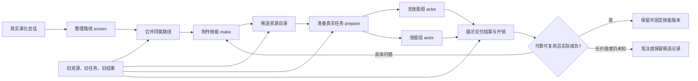

# 唯一管道：从会话接着制作技能和完成任务

设计版本：5.0.36

变更编号：ALG-20261026-09

接口版本：workflow-pipeline-v1

更新日期：2026-10-26

本轮新消融读取器兼容修复与原付费结果接续（5.0.36 / ALG-20261026-09）：用户要求核进度/结果并补失败或基础设施错误。审计发现原12prepare与12source review均原生completed，各仅1attempt，业务Actor/技能make为0；6路线被141条global_quality_standard来源误报阻塞。155个全局引用均已明确声明derived_quality（包含带冒号说明的形式），模型放在具体sources引用处，旧读取器却仅核item顶层严格等值。修复只读取明确来源标记的两种等价位置/冒号说明；引用处优先，明确explicit或缺失/畸形标记仍拒绝。原逐字来源/分值方向/独立语义复核/原题与五维合同不放宽，不变更已付标准、评分锚点、任务或资源。真实12批35题全部重解析及缺basis/explicit负例通过，0新模型请求。

原24原生会话、草案/复核/旧阻塞/费用与1条缺usage保留，均不补跑。只在0make/Actor、原主管已退出时重新收集派生准备状态；旧全block造成的空V政策及空评分移至本轮历史归档，不当已获得独立V结果，未来仍须真实V先冻再H。用户本轮授权恢复原队列总并发上限10，原镜像97a0/OpenClaw2026.9.5/glm-5.3-flash/1800秒32768/6GiB4CPU1GiB shm及原生工具发现/读取/循环不变。当前未发现终态基础设施失败；此接口修复不新增准备/评审模型轮次，总阶段上界326、业务190/H96不变；后续明确基础设施终态失败仍原3attempt规则，completed缺账不重跑。

本次新增实证仅为准备读取误拦及35题离线复核，无新业务收益结果。A保留/旧BCD效果失效、内容N/I/F/L不按retain回退、L/E/V/H与原226/新12H保护、训练预算/模型/生产管道不变。并行5.0.35离线训练数据处理正文与0训练边界全部保留；变更前实际双稿快照history/5.0.35/ablation_basis_reader_recovery_20261026/，源码SHA/原paid归档及协议绑定output/20261026_ablation_v2/recovery_basis_reader_20261026/，接口workflow-pipeline-v1保持。

本轮WRD大规模离线训练集处理（5.0.35 / ALG-20261026-08）：用户授权实际恢复输入、按技能版本和后续试跑归因制作/修订、构建自主调度标注并对应训练计划，不启动训练。离线入口research/data_prep/wrd_dataset_v9/与output/20261026_wrd_dataset_v9/保全全部原思考/动作/反馈/修订，按当时可见输入及资源祖先逐目标隔离原226和新消融H。原system真恢复、固定原生schema重建、学生接口转写分开；加密推理不伪造解密，新增协调标注不冒充教师CoT。

数据流为原件恢复→逐目标准入/输出版本-试跑-反馈图→原生过程与程序规则协调的分别标注→父任务归组/14B与8B共同分词及mask→分片/完整证据封包→QA/Git回读。原技能写入/修订须具体版本与后续试跑支持，done/retain/exit0不自动正loss；未知/错误留上下文mask0。成功读取只低权重工具辅助，不冒充技能质量。新增协调状态不得提前包含未来试跑观察，程序规则/用户来源与原教师分开；源码注解不实现替代Agent循环。完整过程/逐步视图不重复计独立任务，长输入不静默截断，原226及新H不反哺训练/门槛。

本轮只改离线派生数据、计划与Git交付，不改pipeline.py、原生发现/读取/工具执行/返回或会话循环，不动预算、模型权重、黄金/gold、生产入库或正在执行的新消融；新消融继续绑定冻结5.0.33，输出不回流训练。实际数量、源码/原件/编译SHA、QA及发布回执由本轮记忆登记，未生成前不冒称完成。A_B_MODULES同版复核；修改前history/5.0.34/wrd_dataset_v9_20261026/。保留workflow-pipeline-v1，新增wrd-causal-outcome-dataset-v9仅为离线数据接口。

本轮WRD训练数据质量与可达性评估（5.0.34 / ALG-20261026-07，非执行变更）：用户要求重新调研数据充分性并做质量评估。全旧1763会话/32342位置核到10674583原目标tokens，29终包均有过程档案，113个原评审字段投影与后续原生读取连接；但原system捕获/工具schema需补证、语义非全部金标、原226资源闭包和学生自主协调未证，不能由原始量保证14B完整自主沉淀或总成本收益。保留原思考、工具、失败反馈和修订；建议以完整链组织、按正确步骤定位监督，并独立验证学生闭环。此为研究建议与质量事实，不是新准入/训练mask或效果结论。模型14B主/8B对照、原226不反哺训练及门槛、workflow-pipeline-v1接口、原生环境、预算与当前在途实验均不变；新消融继续绑定其原冻结5.0.33执行合同，不被本次评估替换。A_B_MODULES同版复核。修改前同版双稿快照在history/5.0.33/wrd_quality_v8_20261026/；证据、源码SHA、原记录指针及限制见[质量评估](../../output/20261026_wrd_quality_v8/QUALITY_ASSESSMENT.md)与ASSESSMENT_SUMMARY.json。未训练/加载权重/启动新业务或教师，不改旧数据和旧失败。

本轮新消融的来源限定评分接口修复（5.0.33 / ALG-20261026-06）：首批12个原生准备会话均自然终态，制作/业务Actor尚未派发。检查发现草案中有0/1锚点方向倒置、证据类型及全局来源basis不一致，属于准备标准缺陷，不是业务结果。只暂停外层新增派发，在途原生会话按原预算自然结束后才停止旧主管；以原dispatch被动接回结果，0重发。12份原草案、原会话、费用与1份partial计量全部保留，不为补账重跑。

修复共同准备说明，明确1=充分满足、0.5=部分满足、0=不满足，以及合法证据类型/derived_quality。每个原batch另加且仅加1次独立source-only语义复核，共12次；只给原题、原输入和已付草案，不给skills、Actor答案、成本或测试成败。复核逐条核来源/评分方向/交付边界并记录变更，修正结果写独立rubrics_reviewed，不覆盖原草案。外层只核实声明/逐条覆盖/逐字来源及schema，不以关键词自动翻转语义；仍未通过或真实缺输入/主要工作错配的路线显式阻塞，不无限追加复核或改题。正常复核1轮、明确基础设施恢复仍最多3attempt，不改变1800秒/32768/镜像/模型/原生工具循环/10并发。

全部原生阶段上界由314更正为326（增加12个准备语义复核），业务仍190、H96，make/Ereview各30、Vgate6、双Q46及L/E/V/H=6/12/11/12不变；费用完整单列。迁移仅重开0 make/Actor的旧来源接口block并归档派生状态，原jobs字节不变。内容臂不按retain回退N，S*只E演化、V先冻结政策/H不回流、旧A保留/BCD效果失效、原226与新12H保护、训练及并行v6离线数据研究均保持。双稿变更前实际字节快照history/5.0.32/ablation_source_rubric_repair_20261026/，保留同轮并行发布前澄清，运行源码/协议与修复回执由implementation_record绑定；未启动训练/GPU，尚无新业务效果结论。

v6发布前实现澄清（同版非执行）：原数组及mask/来源/原生接口均不变，当前纯R监督约66.5%，旧候选R重放10%目标不再适用，取消该目标并保留片段/父任务预算及总曝光上限3。R边界混合只归R，其他格式/混合仅归格式辅助，保留base权重、token只算一次。加密包内plan是封包快照，外层PUBLIC_PLAN_CORRECTIONS与当前TRAINING_PLAN明确后续澄清；不以修改说明改变实际训练数组。修改前同版快照history/5.0.31/prepublication_loss_clarification_20261026/，与A_B_MODULES.md同步；预算/环境/生产及并行消融设计不改，0训练。

本轮用户授权新消融实际执行（5.0.32 / ALG-20261026-05）：用户明确“开始十并发跑你新设计的消融实验”，覆盖5.0.30仅设计/未授权的旧状态，仅执行新6路线试点。原A保留、旧BCD效果失效及费用留档继续，不重用旧BCD技能/成绩为新有效臂。41个不同原evolution来源分为L6/E12/V11/H12，规范化/附件/原关联组无跨角色冲突，12H不在已审计旧maker/消费源；较早传递血缘和原始顺序限度保留，不冒称普遍未见/原生历史已认证。Windows仅1个独立V，事前缩为探索性V1，故业务Actor上界190（H96/E72/V22）。来源限定rubric准备12场，make/Ereview各最多30、Vgate6、双盲化顺序Q46，合计原生阶段上界314，不含明确基础设施恢复；场次不是provider调用数。H内容臂N/I/F/L不按retain撤技能，S*只据E指定终版；V冻结执行前N/F政策，H不回流。

新科研外层output/20261026_ablation_v2只投递完整会话/声明资源、排总并发10、记全轨迹费用并事后评分；调用未改native.py、原镜像97a0/OpenClaw2026.9.5/glm-5.3-flash/1800秒/32768/6GiB4CPU1GiB shm，原生发现/实际read/工具返回/循环保持。新episode宿主在D，原runtime/账号状态仍E，不重置轮转策略；0模型预热10路已完成。只有L原始source母本给初版make，不以v8语义重建充当原生工具历史；修订只加E证据，V/H不投maker。已完成缺账保持未知、不重复；只补明确终态基础设施失败最多3次，未明不重发。双稿修改前原字节快照history/5.0.31/ablation_v2_execution_20261026/，执行protocol与源码SHA/文档由本轮implementation_record绑定，当前生产、黄金/gold、奖励、训练/数据血缘研究及旧结果均保持。该登记是执行授权和固定实验条件，不新增生产门禁或替代Agent循环。

本轮新增12个H来源及其测试/评审反馈登记在output/20261026_ablation_v2/holdout_registry.json，禁止用于训练、选checkpoint或调阈值；原226隔离不变。新episode根目录默认不进入未经审核的训练导出。H前冻结的技能字节不因后续测试被倒标成H派生，未来数据准入仍核真实创建前血缘。该保护只固定本实验留出边界，不干预其他已授权离线数据任务或启动训练。

本轮资源血缘与可训练过程数据v6（5.0.31 / ALG-20261026-04）：用户授权核清固定91、整理真正能训练的完整过程、解释因果链并Git交付；原226继续隔离，不训练。新离线控制流为冻结Git4cc8fdb的91及旧原R依赖→原始消息/工具返回/投递CAS精确绑定→实际read与目录可用分离→创建前prefix及确定复制/投影的有限资源闭包→来源准入→已知质量与协议/长度/owner审核→实际正loss数组/原始上下文/动作—观察—反馈—修订边→独立核验→公开投影与受控原件增量→manifest/入口及远端读回。未知作者/路径不算确定污染，不能从mixed teacher上下文剪掉中段洗白后续响应；晚于资源创建的观察也不能倒污染早期字节。原226正文/反馈/确定派生资源不训练或调参，原始档案保全。来源与格式/已知质量过关的数据可进入过程SFT正例，完整自主就绪仍独立核验、不因未授权训练全体置0。

每个数据片段保留原episode边界、source SHA、当时prefix、原R/可见解释/工具动作与实际结果；跨会话链以artifact/job/version证据连接，不拼成未发生的自主原生会话。当前A/B/C-prepare/C-review/D覆盖、原R、完整阶段/前缀及完整自主链数以v6最终报告为准；legacy业务screen及写SKILL.md不冒充A筛选/D冻结。14B/8B同来源同曝光、LoRA与分段损失起点保持，新增按实数计算更新步及数据—优化—能力证伪合同，未启动训练器、学生采样或替代Agent循环。新科学脚本wrd_reasoning_v6与计划20261026_wrd_lineage_v6；修改前双稿快照history/5.0.30/resource_lineage_v6_20261026/，与A_B_MODULES.md同版。并行5.0.30旧BCD科学效果失效、非执行消融方案与历史账保持，失效收益不作合格技能gold。现行接口、镜像/工具/预算、gold奖励和生产不变，最终清单/源码SHA和Git回执绑定。

v6同轮最终数量与预算复核：91终态54保护依赖/36具体缺证/1旧业务source通过但协议不合格，91的WRD core正例0；全母表现仅43 Actor辅助窗可过程SFT。历史116资源闭包通过，10已知质量目标保持零loss后106主过程（30原R）182659监督/R121511tokens，8个历史企业源，5raw版本非独立来源；完整原生A—D自主链0。未来曝光按实际窗口/acc16算7主更新/遍，1/2/3父曝光候选与R上限3，额外反馈≤0.5计入总≤3；不运行搜索，阶段权重不填补缺失原生阶段。过程数据ready、完整自主ready=false并存，实际正例/资源/原件/全mask/独立QA/Git回执分别绑定，不用候选或Actor数量替代完整沉淀覆盖。原226与正式250边界不变。

本轮消融重设计与旧实验失效（5.0.30 / ALG-20261026-03）：用户保留A，原B/C/D效果实验全部失效，附件仅参考。原jobs/status/产物/费用不改，由plans/20261026_ablation_redesign/invalidation.json覆盖科学有效性标志；旧BCD不得进入新效果表、也不凭补评分恢复有效，不沿旧运行授权接续新方案。新方案仅设计，execution_authorized=false/ready_to_run=false，未修改pipeline.py/native.py/stages.py或启动原生模型会话。

拟议科研输入流为先冻结来源依赖与L/E/V/H、任务/rubric/重复→原生make得到真实S0→只用E局部修订最多4轮并指定S*→机械生成同知识平铺变体→V的N/S*配对冻结部署政策→H同题N/I/F/L四臂→盲评TSR/Q与全请求费用。外层仍只投递资源、启动原生会话、记账和事后评分，不替模型预读、强制用技能、改工具返回或提前收尾。内容臂不按retain变成N；缺包显式记构建失败，政策回退另报。完全相同条件只引用一次真实结果并保留共享映射，不能计成独立重复。D′以V冻结的执行前N/S*选择索引H配对结果，实际全矩阵研究支出和政策归属成本分开，不模拟免费失败回退；只回答固定路由的成本准入效应。

推荐6路线探索试点业务Actor≤192，制作/流程审阅另≤60，Q与基础设施恢复另列；来源、技术初版链、组件可分性未证实，不保证样本量/功效。原生97a0/OpenClaw2026.9.5/glm-5.3-flash/1800秒/32768及总并发10保持为未来共同合同，实际执行清单另核。workflow-pipeline-v1、训练数据5.0.29范围、gold/奖励、技能生产入库及历史账保持；新增只是方案与validity-overlay，不增加生产审批/门禁或第二Agent循环。前置双稿快照history/5.0.29/ablation_redesign_20261026/，实际源码/文件SHA见新方案implementation_record.json；与A_B_MODULES.md同版本。以下旧BCD在途/待评分条款保持历史身份，效力由本段覆盖。

本轮固定原226边界及失败关闭准入（5.0.29 / ALG-20261026-02）：用户确认“继续隔离原226来源，保留原评测边界”。输入源及其衍生反馈不得训练、补注回流、选checkpoint或校准门槛，旧逻辑evolution标签不得绕过该约束。离线追加流为：原始消息/工具观察及源SHA→requests/text与串接JSON提取→实际正文/路径指针分辨→历史直接来源清单更正→资源血缘待核与已证事实分档→保守因果前缀单列→当前入口/计划/manifest/Git读回同步。旧276本地/85公开只是v4直接来源候选基线，不能跳过新overlay或当完整传递隔离。quality-silver标志不等于最终训练准入；当前最终准入清单为空、训练默认null、未授权启动、完整自主就绪false。所有原始/负结果保留，触发保护资源的read动作及后续内容不进入恢复前缀。未启动原生会话或替代Agent循环。双稿修改前快照history/5.0.28/strict226_confirmed_20261026/，与A_B_MODULES.md同版本；模型/参数建议、现行schema、原生工具环境、预算、gold/奖励、生产及独立B/C不变。最终报告/源码SHA和远端验证绑定本轮回执。

同轮组件口径复核（5.0.28，参数/数组不变）：E/D按原工具调用有无划分普通正文载体，D不只语义决定，write内reason可属于A；规范性判断仍由原标签/实际结果/独立审阅提供，不能从结构字母推断全量gold。公开加载说明与PLAN补字段，原input_ids/spans/模板及接口、预算、训练参数均不改。快照history/5.0.28/reasoning_carrier_clarification_20261026/，与A_B_MODULES.md同版复核，无新执行。

本轮原思考数据恢复与非执行蒸馏计划v4（5.0.28 / ALG-20261026-01）：用户要求先调研、完善方案、追全部原始思考/输出、因果可靠且有训练价值的数据与Git交付，不训练。新离线流：一手Agent/推理蒸馏研究→锁定分段/反馈/控制方案→原request/response/SSE及native追溯→逐帧拼接与content/源SHA比对→源划分和原动作结局→显式因果模板/目标归属/双分词器→已知语义拒收/资源语法覆盖→严格来源及宽候选分档→清理公开投影/数组/manifest/Git核验。全流程离线科学数据处理，不接管原生Agent循环或执行旧代码。

恢复与真实因果：SSE68流67真思考1301758字符，旧67 response.json实际遗漏R；原流不改。1233原对1087相邻前缀/响应续接全部精确一致；97新增历史native与旧1763去重（16个同session字节不同的旧派生视图保留索引不重复计新会话）。原SSE45 source-proven中12REJECTED整响应loss0、33仅与原结局相容，FINISH READY不当retain；6例AI读全思考审查另1事实边界暂缓，非human gold。历史原模型/工具/源文件身份与当前native条件分层；原始思考不以摘要替代，未记录/密文/空reasoning元数据不编造或解密。

实际数组：最终历史补充116≤32K正面候选196294监督/30含R121511tokens；当前原生质量层本地943沉淀窗2158671监督，Actor490独立，公开468/1333855。9length/61原AI拒绝（schema/clamp更正覆盖）/write.py-json语法均单独控制；官方资产等价缓存与独立canary/抽验如实描述，未做的全量双调用不冒称。每原target一处loss，system/user/tool观察/pad/错误及非归属历史=-100；完整阶段与显式前缀覆盖分别报告，超32K不静默截断。因果模板是显式变体，原文孤立think分隔符不重解释为原思考；未来模型API需同模板，当前未接线/无权重或GPU。

5.0.28历史来源审计基线：catalog.source_ids原本跨最新route用正则扩散，不能当实际可见源。当时327 selected/原user-tool正文可观察依赖，349仅源池可用、785直接evolution、302弱/不明；旧666可用池混淆版留历史。旧直接来源候选本地276窗478451监督、公开85窗198769，A/prepare覆盖不足。5.0.29用户已确认保留原226评测边界；新可见性overlay撤出1个prepare整场，当前本地275窗476418候选监督、公开85不变；9个首发现前缀单列。最终训练准入0，不发布“完整目标已足量”，不把文件可用称已读。全部母本与未知项保留，完整资源祖先/语义去重隔离未证明；正式当前250问题/反馈不反哺。

新计划plans/20261025_wrd_reasoning_distillation_v4/：14B主8B对照同数据/曝光/验收，BF16 LoRA r32/a64；短原思考→完整资源/多轮→真实修订/自主状态控制，R/E/A/D建议0.25/0.10/0.45/0.20＋格式0.02、父样本/阶段均衡；主一遍/修订最多0.5、R父样本最多两次、Actor≤10%/派生≤20%。旧高层READ/UPDATE/TRY需声明协议投影，不能只改名为原生调用；原模型/外层编排/助手补注三分，不伪装原生一条完整长会话。两次sessions_spawn accepted仅能力证据下界，固定Actor双臂与单次输入无人阶段指挥的端到端仍必须未来验收。DPO无同状态可靠对不做，on-policy/RL不启动，静态数据检查不冒充模型已达标。

同版复核：新增wrd-reasoning-distillation-plan-v4及因果原始/编译/范围schema；workflow-pipeline-v1、原固定OpenClaw镜像/发现读取工具返回/1800秒32768/实际队列/skills/gold奖励/生产入库/历史费用保持，不干预5.0.27独立B/C恢复。TSR与独立Q、K_Q/K_R/K_G和完整失败/修订/回退/人工/训练摊销继续。快照history/5.0.27/wrd_reasoning_v4_20261026/，与A_B_MODULES.md同步，实际源码与报告/数组/公开Git回执SHA绑定。0训练/权重/GPU/新业务教师ActorJudge，助手科研标注服务成本未知，不宣称零成本。

恢复真实回执补充（执行协议5.0.27）：主管15492已实际10路接续，10lane均新native_usage/stream_end，固定镜像与1800/32768/容器资源核验一致；128已完成业务/引用题位保护。用户随后补充此前模型服务可能未开启，此为用户故障背景判断，现有真实回执确认当前可用；此前120秒握手超时不扩大为已证实的服务内部损坏。当前仍在运行，未宣称B/C/D已完成或效果成立。见memory/2026-10-25_bc_recovery_fixed_and_resumed.md与恢复launch_receipt.json；其他并行非执行研究计划和本版合同保持。

本轮B/C宿主接入恢复（5.0.27）：本轮用户要求修复B/C中断。5.0.25已修复None计数/Docker准入超时，但首批真实会话仍返回HTTP500；进一步定位旧宿主桥接池CodeBuddy启动握手反复120秒超时。保全并暂停外层新派发，在途原生会话按原1800秒自然结束，接回10个终态，其中3场业务完成；没有强制终止业务。随后重启10路独占宿主桥接/后端，以原BackendPool和同一SDK/账号状态、32768及DelegateTool串行启动，10路均2–3秒通过TCP就绪，0模型请求。原生97a0镜像/OpenClaw2026.9.5/glm-5.3-flash/1800/32768/6GiB4CPU、总并发10、原任务/资源/来源分组/库版本不变，原native.py/stages.py/桥接源码与旧账不改。恢复128个已完成业务/引用题位，9个明确基础设施失败补跑；仅列出的6个已耗尽旧3次、最后为启动前HTTP500且无provider请求记录的题位，接入根因修复后额外验收1次、总最多4。其他仍最多3，真实耗尽1800预算不补，所有旧费用/未知及版本链保留。恢复一份已付费完整retain评审的读取，原native失败终态不改；开发证据变化才刷新过期评审，资源条件变化另立测试题位，测试不回流。11项回归与128完成项干跑保护通过。入口output/20261025_ablation_remaining/recovery2_20261025/run_recovery.py；实际源码SHA见恢复protocol.source_sha，协议SHA 8000bb7966ab3503be608f3e3f4048a1484b227218b339258a8daff598d5d8b1。本轮期间其他授权会话写入的5.0.26全流程蒸馏非执行计划完整保留，不修改其数据/训练计划；本次只接续独立消融，不训练/GPU。修改前双稿快照history/5.0.26/bc_host_transport_repair_20261025/，两稿同版5.0.27/ALG-20261025-13，接口workflow-pipeline-v1不变。

本轮全流程蒸馏接线更正与非执行计划（5.0.26 / ALG-20261025-12）：用户要求继续扩充、必要时补标注，先交付数据量/算法/结果的具体计划，不启动训练。旧make/screen子集和93技术银标不是完整WRD训练主集。全阶段母表1763会话/32342助手位置，沉淀角色1199会话/19728非空候选，Actor526/11683、历史38/603分角色；资源阶段文本2866，父文档/字段15104、review→修订make151对（117有前序make）、4364确切边。73路线出现make/prepare/actor/review不等于均有效独立。缺canonical59仅24请求/27结果、没有完整中间轨迹，保留缺口；最终主集语义准入/双模型mask/16K32K覆盖仍未完成。329prepare旧标记因禁读测试集语句误触，保留原flag并做policy-only归因，不由此证明无污染。

离线流为冻结记录与CAS→全阶段消息/原产物→带SHA/JSON pointer的原字段提取→确切引用/版本修订图→时点可见的证据决策摘要及结果核验→来源隔离→共同编译/目标归属与mask→最终训练manifest。只使用每个决策之前可见状态；未来产物可作后验审核，不塞入过去prompt。错误动作是masked历史，正确诊断/修订/拒绝可分别监督；整场成败不自动传播给每一步。新增摘要为派生视图，标注者与parent曝光预算显式；不假造一条跨会话原生长轨迹或重复切片凑独立数据。原归档检查未找到已定义推理正文，thinking=off不是CoT；可见解释9723条（沉淀6045），摘要不冒充隐藏推理。

未来训练与评估按plans/20261025_wrd_fullchain_distillation/：14B主/8B对照、同来源/监督曝光/接口、BF16 LoRA r32/a64；短决策→完整资源/多轮过程→反馈修订/阶段转换。核心A/B/C/D建议权重0.20/0.35/0.30/0.15，Actor显式辅助最多10%；主规范化一遍加修订最多0.5监督token倍数、摘要最多替换20%，均待验证。完整窗口所有准入assistant目标有loss，其余历史/system/user/tool/pad=-100，同一目标重叠窗口只一处归属；16K/32K是总长且不静默截断。DPO仅同状态可靠对、无已核对数，在线/ReST/RL不启动。来源依赖保守图一个1667大分量加96单例，独立泛化组未知，不随机切动作。拟24组两消费的T/S8/S14主72制作/192消费槽位，Q/TSR非劣容忍5分/5个百分点及运营CPQS降30%只是待校准建议，不承诺统计功效或实际收益。

生产/公开边界：计划与离线导出不是执行器，不接管原生Agent循环、技能发现读取或工具返回。用户原A—D与局部资源修订闭环及固定Actor双臂验证保留，质量Q与TSR分开，K_Q/K_R/K_G和全部失败/修订/验证/人工/教师回退/训练摊销保留。本地训练许可独立于公开许可；既有已清理公开1051会话/17513候选可扩展导出，受控敏感正文不直接上网，旧包/源/账与正式226/250不改、不回流。本轮0训练/权重/GPU/新教师ActorJudge，不触碰5.0.25其他任务的消融恢复、队列与原生公共预算。

同版登记：workflow-pipeline-v1、旧bundle-v1及preflight-v1保留，新增wrd-fullchain-distillation-plan-v3/data-ledger-v3元数据；脚本research/data_prep/wrd_training_fullchain/及SHA绑定报告/公开manifest/Git回执。修改前快照history/5.0.25/fullchain_distillation_plan_20261025/，与A_B_MODULES.md同版复核；黄金/gold奖励、现行资源投递、1800秒及32768、入库执行不变。

本轮B/C基础设施与外层调度恢复（5.0.25）：本轮用户明确要求解决并修复B/C中途停止，接续前轮授权未完成消融，总并发10、原生环境/预算不变。旧主管已退出，Docker Desktop引擎/代理无响应；官方restart失败后保全进程证据，仅重启Docker应用及docker-desktop发行版，未重置/删除镜像或卷。恢复后原97a0镜像SHA核对一致。外层修复位于output/20261025_ablation_remaining/recovery_20261025/，原run.py/native.py/stages.py和旧账不改；空计数保持未知，明确HTTP500/未耗满1800的provider超时最多3次同条件尝试；Docker全局准入串行核对并保留启动预约，总10，查询超时等待恢复不退出。恢复清单为9个明确基础设施失败补跑、7个未dispatch项接续；125个已完成业务/引用题位保护，耗尽1800预算的负结果不重跑，不明已dispatch隔离。另恢复读取一份已有完整结构化retain评审：host自然结束、gateway关闭、usage完整，原native failed/退出码仍保留，不重复付费；该规则统一适用于所有决策，不按好坏选择。补齐开发证据时只刷新过期评审；已付修订链保留，资源条件变化生成独立题位，旧测试/费用保留，测试不回流maker。冻结原题/来源组/12路线/29-121-29库及原10profiles、bridge、runtime、服务状态；本轮不改来源/适配规则，不重新选题或新增训练/GPU。已通过10项针对实际故障的离线回归及完整状态干跑；源码SHA见恢复protocol.source_sha，协议SHA 0008298af69f34bde467adaab3522726c2a3fd72a207d07ddc8a96603785ccb9。修改前同版双稿快照history/5.0.24/bc_recovery_20261025/，两稿同版5.0.25/ALG-20261025-11。

本轮消融离线结果复核（同版5.0.24，执行合同不变）：用户要求核实完成并交付全部结果与是否符合预期。A补5题位已账齐，当前196选中结果均完整实测，NS/Route/Resource/Full分别49/48/48/49交付，Token41881469/40030141/42986089/32609313、调用720/688/735/547。Full相对NS总Token少22.14%、调用少24.03%，14路线簇探索区间对NS含0，不声称统计稳定或Q提升。B/C仅21份明确评审、0保留，当前126逻辑测试全部NS回退；1路线缺材料、4开发/评审未结束，未形成内容机制对照。D750中9历史复用、0新增执行。原主管33612于20:28后已退出：3路HTTP500后空调用计数触发TypeError，其余7路Docker查询超时且未派发；本轮Docker10秒探测仍超时，不能结项。全部376物理尝试去重，实测458103213＋旧估63104，34请求缺usage、另3场请求数未知；原账不改，0新业务模型/训练、未恢复Docker或重派完成项。报告及冻结账见output/20261025_ablation_remaining/summary_20261025/；只新增离线派生结果与报告入口，不调整制作/准入/测试协议、模型、数据或预算。修改前同版快照history/5.0.24/results_audit_20261025/，与A_B_MODULES.md同版复核。

本轮消融执行登记（5.0.24 / ALG-20261025-10）：本轮用户明确授权补跑计量/基础设施失败并开展其余消融，总原生并发10。新增独立科研调度器 output/20261025_ablation_remaining/run.py；原 native.py、stages.py、bridge/runtime 和生产库不改。A仅5个缺账题位重新计量，旧6请求缺失及旧quota费用继续保留，普通交付负结果不择优重跑。B/C固定12条非结果特征路线，先真实用户需求召回并按来源/相同用户消息/附件连通组隔离四题，2开发2测试后分支；不足则明确blocked。共同全会话v0供B无修订和C Full；B反馈最多4轮，仅具体资源缺陷修订；C仅用户消息含全部纠正及同一真实附件，无旧派生资源。相同开发/取舍政策、三重复，未保留回退NS，测试不回流。语义近重复独立性仍未知，不冒充新盲测。D冻结当前121可发现包（不代表可靠）、开发保留29、类别内固定种子20261025随机29，统一类别候选与原生自主发现，250既有题×3库一次；相同条件复用。原生97a0镜像/2026.9.5/glm-5.3-flash/1800秒/32768/6GiB4CPU1GiB shm不变。E空间不足仅新episode宿主存储移D。每job最多3尝试，只为缺账或明确基础设施错误；不明dispatch不重派。全尝试实测/估算/未知分列，Q未评分，货币价格未知。算法主链/训练/SFT和生产state.db不变。本次协议SHA 5c7c8a9ded46fe369f326452d8320e70a6cb2b78c01a14f5a5216f0daf6ab9d8；科研源码SHA见协议source_sha。

本轮Git最终回执（5.0.23任务交付）：WRD_dataset/codex/wrd-training-data-20261025已上传数据4cf8d4de64b606e726b36032171961bd880a7f74与更正/回执befa69e0d6698ce0f76e740f28ef9007a515a45c；当前MANIFEST SHA0416d156feec2605917f39a89a13a5b9d3c92197f78330831bff75cff9e1f50b，114载荷461279134字节。fresh bare clone+独立空LFS缓存逐文件取回复核71普通Git载荷/43 LFS对象全SHA/bytes通过，未取旧3GB或受控B数组。源码/输入/数组SHA由MANIFEST与output/20261025_wrd_training_preflight/FINAL_UPLOAD_RECEIPT.json绑定；更正overlay保留旧记录且93正例不变。发布/校验已完成，0训练/权重/GPU，完整SFT准入仍未满足。回执前同版快照history/5.0.23/training_preflight_final_git_receipt_20261025/，与A_B_MODULES.md一致。

本轮标签更正（同轮5.0.23，旧输入和审阅回执不改）：c87e2acebe31b14583ca4d0f的“timeout90000违反schema最大30000”依据有误，固定schema无maximum，原生描述是高值限幅30000。以ANNOTATION_ERRATA.json追加overlay改为needs_context；旧425汇总250/62/113仍是原快照，overlay后250pass/61reject/114needs。该条原即受控且final_admitted=false，134/93准入及全部源输入/数组/mask不变，不重新分词或伪造历史。更正前同版双稿快照history/5.0.23/training_preflight_annotation_erratum_20261025/，与A_B_MODULES.md同步。

训练前审核交付复核（5.0.23 / ALG-20261025-09）：本轮5.0.21数据授权完成标签恢复→7117全结构检查→425目标AI局部审阅（动作300另60二审）→统一隐私/跨列门→公开及全7117两域CPU双tokenizer/mask→最终准入→新空staging/receipt核验→Git交付。不是Agent执行器，不加载权重/GPU/训练或新教师ActorJudge。5.0.22消融恢复、原生环境、任务/技能、黄金/gold奖励、预算及生产入库保持；不取其正式输出反哺。workflow-pipeline-v1、旧bundle-v1、SFT-plan-v2保留，派生wrd-training-preflight-v1。修改前双稿快照history/5.0.22/training_preflight_delivery_20261025/，与A_B_MODULES.md同版复核。

接口实测：7117母表、4116公开正文、134编译前银标；全域7100成功/17前缀失败，≤16K1998、≤32K4874；公开4109成功/7失败，≤16K1604、≤32K3236，跨域公共4109 ID/token/mask/长度一致。admission额外重验源行/文件SHA、协议、数组、span及-100重建和完整分母；status PASS/release_ready只表示技术交付完整性。SFT互斥短32/长61，共93，1620754输入/18205监督tokens；候选training_eligible仅编译前标志，最终入口以final_admitted为准。超长/未审/拒收/hold保留，不截断、重复曝光凑样本或扩子decision独立计数。

标签/公开边界：347真实末条恢复、343核心＋4隔离；36直写546子决定与63最终产物1292决定/661路线分开，2缺产物/337exec不盲转正例。AI非人工gold，独立dev/test0，单连通；300抽审未过建议95%观察门。最终直接路线写入仅1父样本含16reuse，其他分支仍待准入；93含83工具/10收尾不足原128—256 smoke池，不自动扩训练。公开支持4078/4750及原生历史1051/1763是完整记录子集，非额外主训练样本。6071受控记录以basename/行序/recordSHA给无正文定位；654948别名全哈希清单不表示全原字节已公开。私盐/原映射、疑似敏感正文和B域受控数组不上传，旧LFS不重传；公开输入exact SHA可复跑，受控域只交无正文统计。

实施绑定：research/data_prep/wrd_training_preflight/实际SHA、output/20261025_wrd_training_preflight/报告/新发布MANIFEST、同版复核与远端Git回执同轮登记。发布器只组装新空staging，重验FINAL→compiler→源/数组两级receipt，再核对Git/LFS。CPU wall time不是Spark训练吞吐或CPQS；模型/未来LoRA参数不改，后续先补关键路线分支/终态和新独立来源。原负例、费用、失败、未知保留，不把旧格式/去凭据缺陷直接写成方法或教师质量结论。

本轮消融基础设施恢复（5.0.22 / ALG-20261025-08）：用户明确补跑额度及其他基础设施错误、完成不重复、同环境预算、继续10并发。原主管18672已于15:30:44自然退出，196逻辑题位中186条已完成或严格引用保护；仅10场429/category=quota/code14018确认可补，其他基础设施失败/未明均0。原失败consumer与容器终止、host cleanup0后新建独立attempt2目录；旧result/dispatch/usage与10次缺用量请求原样保留，不清零或覆写。

恢复接线：output/20261025_ablation49/recovery_20261025仅放薄包装、恢复协议、审计/新状态与全部尝试成本引用。包装导入原外层run.py、使用未改native.py和原10lane/profile/native runtime/bridge/服务状态，实际196cell=186 action reuse+10 action run；原失败目录不作为新episode复发。原196协议、49任务/163附件、18包变体/Full及原源码SHA保持；每lane只有其原失败cell，实际总并发10。无在途主管叠加，不停止健康原生会话。恢复完成后当前结果与原失败账分列，主进度入口可指向恢复页，原页/旧完成结果先存档不丢。

同版登记：design_revision=5.0.22、change_id=ALG-20261025-08、schema_version=workflow-pipeline-v1及旧数据/训练接口保持，ablation49-infrastructure-recovery-v1只是外层恢复元数据。固定97a0/OpenClaw2026.9.5/glm-5.3-flash/1800秒/32768/6GiB4CPU、原生工具返回/循环、资源/提示/任务匹配、训练/gold/黄金/奖励/生产入库不变；不重跑内容失败或完成缺账，不扩大其他消融。修改前history/5.0.21/ablation49_infra_recovery_20261025/双稿快照，原/恢复协议与源码SHA由本轮恢复回执绑定；与A_B_MODULES.md复核。用户新授权覆盖同项先前不补跑限制，未来未明不盲发，已有完成继续保护。

本轮离线训练前整理（5.0.21 / ALG-20261025-07）：用户授权数据审核/路线决策和收尾标签、14B与8B共同样本/loss mask/16K—32K覆盖及Git资料交付，仍明确不训练。离线入口research/data_prep/wrd_training_preflight/只读旧bundle：恢复真实标签→实际工具结果及格式全查→分层AI审阅→统一去标识/公开隔离→CPU双模型token/mask→分片/清单/远端核验。不是Agent执行器，不加载模型权重/启动GPU或新教师ActorJudge；在途49题消融、原源/技能/费用保持。

接线与公开影响：目标沿原target位置，不把write子decision当新独立样本或最终产物倒灌历史。编译器分列publication_approved与training_eligible，缺失默认false，报告候选/可公开/准入分母，超长/schema失败保留。旧工具错误标志和文件写出不保证内容收到或资源可用；新拒绝理由保留、不修改原target伪造通过。AI审核非人工gold、未决不转通过。用户允许企业语义公开，故可提供处理后候选/标签/数组/工具/分词器/代码和支持证据；“忽略风险”不用于公开凭据或第三方敏感个人资料。疑似敏感与原二进制留本地受控、清单明示；不改写旧原始包或自动重传其LFS。

同版登记：design_revision=5.0.21、change_id=ALG-20261025-07，schema_version=workflow-pipeline-v1、旧包wrd-training-bundle-v1与方案wrd-sft-plan-v2保持，新增wrd-training-preflight-v1；产物output/20261025_wrd_training_preflight，脚本/分词资产/实际编译/新文件与远端SHA绑定。当前黄金/gold奖励/模型权重/原生资源投递与工具返回/1800秒及32768/入库生产合同和旧实验不变。修改前5.0.20双稿快照history/5.0.20/training_preflight_20261025/，与A_B_MODULES.md复核；下文消融在途授权保持，不停止它来完成数据准备。

本轮实验A一次运行授权（5.0.20 / ALG-20261025-06）：用户明确49题×Full/Route-only/Resource-only/No-Skill各一次，总并发10；严格同条件既有结果直接引用，不得因未采用、负结果、失败或缺用量再付费。本轮196逻辑题位，严格复用数和新增数由逐题审计确定，不扩三重复/B/C/D。现行49题和163附件已冻结到output/20261025_ablation49/frozen/tasks，所有附件SHA与当前任务索引一致。

外层科研执行：本轮目录承载固定manifest、变体、复用证据、外层调度及汇总；实际消费仍逐会话调用未改research/workflow/native.py::run_native，使用已修HTTP端口许可的既有固定原生runtime/bridge模板。10独立8080—8089通道在途前确认空闲，总业务容器上限10，原8068—8076旧9服务不关闭/替换。外层只投递/启动/记录，不接管技能发现读取、工具返回或会话收尾；既有result/dispatch按原native规则引用或接回，未明不自动重发，终态失败和费用保留。完整交付/Q事后独立，不能用TSR代Q。

处理与接口影响：Full具体包版本及task→route在新结果出现前固定；独立变体维持相同原技能身份与适用元数据。Route-only去外置/内联资产并修正悬空调用；Resource-only保留资源字节与最小用法，内联资产逐字移到资源并记录SHA/span，资源文档中流程残留显式标注。旧原题/附件/技能/成绩/原费用/生产队列均不变。native镜像97a0/OpenClaw2026.9.5/Actor glm-5.3-flash/1800秒/32768/6GiB4CPU，模型训练/gold/黄金/奖励/生产入库保持。实际执行protocol、复用审计、源码SHA及Windows启动回执落本轮目录，准备不冒充启动。

同版登记：design_revision=5.0.20、change_id=ALG-20261025-06、schema_version=workflow-pipeline-v1和wrd-training-bundle-v1、wrd-sft-plan-v2保持；ablation49-execution-v1仅外层科研元数据。修改前双稿快照history/5.0.19/ablation49_execution_20261025/；与A_B_MODULES.md同步。本次用户授权覆盖下文只方案限制，仅执行第一项一次，不恢复开发skills、扩全量重生成或其他实验。

本轮消融调研与非执行方案（5.0.19 / ALG-20261025-05）：用户报告主实验完成，要求调研并给方案，未授权新实验。先固定当前任务/附件、路线映射、包版本与公共环境，在全部49静态强匹配题上规划Full/Route-only/Resource-only/No-Skill四组；49对应当前题面与实际附件仍须复核，35采用和41实际读用为事后诊断。四组一次196、三重复588测试会话为建议工作量，不自动折抵历史Full/No-Skill。第二实验共享v0和来源，0轮/最多4轮开发反馈修订，用独立测试评价；完整交互证据与效能筛选另建生成/库级对照，不能从29个留存赢家反推全部候选。详见[消融调研与方案](../plans/2026-10-25_ablation_research_and_plan.md)。

控制流/接口影响：本轮不实现变体投递、不改pipeline.py/native.py/stages.py，不改队列、执行状态或正式数据/成绩；不启动生成/Actor/Judge/训练/自动化。未来只按声明改变资源或制作输入，不改原生OpenClaw发现/读取/工具返回与会话循环；Resource-only最小调用接口保留，Route-only同步去掉悬空引用，所有组相同原始任务/用户最终要求/附件/公共工具/预算。实验A固定适用技能，只回答匹配后内容机制，不冒充整库自主选择；筛选实验在共同可消费候选池和固定匹配器上开展。TSR、独立Q、制作与全部消费尝试成本分列，未知不补零；首版/末版开发诊断与未见测试分开。

同版登记：design_revision=5.0.19、change_id=ALG-20261025-05，schema_version=workflow-pipeline-v1、wrd-training-bundle-v1及wrd-sft-plan-v2不变，无新执行schema。修改前双稿快照history/5.0.18/ablation_plan_20261025/；当前源码HEAD及三文件SHA由方案末节登记，不设运行时版本关卡。模型/训练参数/奖励/gold/黄金/原生工具/资源生产投递/1800秒与32768/入库逻辑/历史费用均不变；本轮无新增项目效果实证。与A_B_MODULES.md同版复核，以下5.0.18及更早是历史变更记录，其未冲突运行合同继续适用。

本轮14B主/8B对照计划（5.0.18 / ALG-20261025-04）：用户明确扩大主模型为14B，8B对照，比较skills质量和每合格技能全成本，要求上传详细计划且先不训练。计划位于[新目录](../plans/20261025_wrd_14b_spark/README.md)，配置execution_authorized=false/is_launch_config=false。共同样本/模板/mask/曝光/长度合同，候选Qwen3-14B及8B BF16 LoRA，固定配方与有限实用LR选择分开；当前0语义gold/0token mask、严格1关联组保持。后续顺序仅拟议：准入及终态标签→共同token覆盖/独立来源→有界兼容计量→独立smoke→主SFT→新来源开发/盲测；无另建训练执行器或Agent循环。

质量/成本文件明确K_Q/K_R/K_G，K_R采用当前版本活动业务全部尝试含失败重试的totals，不能用completed_totals替代；可靠、真实复用、全部任务达线且账齐及Token/调用合计双降，逐题变化另列。主每合格技能成本用K_G交集，包含所有分配来源的失败、资源复现、修订、资格消费/评审/人工/回退；训练投入、运营和摊销分列，共享账只计一次，unknown/零合格不按零。三主臂开发6组18/24基础槽位、有限base补后24制作/30消费；盲测24组×2任务主72/192、有限base补后84/216。均不含后继修订重试，不是已经存在的任务或执行授权，功效/质量校准仍待。

Git边界已按新用户答复收口：本轮GitHub private=false，用户明确保持公开且仅传无企业内容计划。发布仅新方案白名单及首页入口，不上传本双稿全文/研究记忆/会话/样本/技能/原证据、凭据或其他工作区改动；不改可见性、不重包或重传已交付LFS。先完成可审阅计划和静态校验，再仅提交白名单并核远端ref/文件SHA。不是复用此前private=true状态，也不把旧数据包重新脱敏声明为本轮完成。

同版登记：design_revision=5.0.18、change_id=ALG-20261025-04，schema_version=workflow-pipeline-v1及数据wrd-training-bundle-v1保持，方案wrd-sft-plan-v2、新质量成本协议/schema只描述未执行接口。无Spark连接/安装/权重下载/token编译/GPU基准/新教师或业务/训练/自动化。未来模型与参数为显式研究变量；当前原生OpenClaw镜像/工具/资源投递/预算、gold/黄金、奖励、技能入库生产逻辑、历史结果费用均不改。修改前5.0.17双稿快照history/5.0.17/spark_14b_main_20261025/，源码SHA与本轮计划交付回执绑定，与A_B_MODULES.md同步。以下5.0.17及更早为历史记录。

本轮新增离线训练方案（5.0.17 / ALG-20261025-03）：用户提供DGX Spark GB10 ARM64 / 121GiB统一内存，要求7B—9B模型、SFT配置、skills质量与算力成本验证方案，明确先不训练。详见[完整方案](../plans/2026-10-25_wrd_8b_spark_sft.md)与非执行JSON参数。建议Qwen/Qwen3-8B BF16 LoRA，候选NVIDIA ARM64 PyTorch镜像与依赖需要未来锁digest及实际验证。本轮不连接Spark、不安装/下载权重、不编译token或跑GPU前后向、不派教师/Actor/Judge、不改pipeline.py或原生会话循环。新增的是方案文档，不是第二条执行入口。

未来顺序为语义准入与screen真实决策标签→目标模板/token/mask与8k/16k/32k覆盖→获执行授权后的有界兼容计量→独立试点adapter→从原基座主SFT→新来源制作及固定Actor消费评测。当前6774动作(make6200/screen574)、0语义gold/0token mask及严格1组事实保持；本轮仅另核347最终回答元数据为make282/screen65，不能等同独立分类标签。不能随机拆现有动作制造盲测，正式226/250与评测反馈不反哺。长序列不静默截断，masked前缀仍计计算成本。未来制作侧模型有意变化须事前登记，消费侧原固定镜像/模型/工具/预算保持；Spark作为模型服务器，不因ARM更换参考工具环境或外层接管步骤。

同版影响说明：design_revision=5.0.17、change_id=ALG-20261025-03，schema_version=workflow-pipeline-v1与数据wrd-training-bundle-v1保持；新增wrd-sft-plan-v1仅描述未执行方案。模型/训练参数/准入/计量与新评测规模均为研究建议；当前黄金复跑、奖励、资源投递、业务1800秒/32768预算、库保留条件与历史费用不变。TSR与Q独立、全部失败/重试/回退和未知成本保留；不把FP4推理规格/空闲功耗当训练吞吐或电耗。修改前5.0.16双稿保存在history/5.0.16/spark_sft_plan_20261025/；方案记录绑定当前源码HEAD与文档SHA。与A_B_MODULES.md同步复核，以下5.0.16及更早内容为历史轮次。

同轮实施补记：离线工具已形成主归档build、历史补录history、日志supplement、晚期版本late_versions、二次脱密sanitize_archive、动作导出training、逐条核验verify_training及分片/恢复delivery。1822引用/1763消息过程、6774标准动作与64文件匹配动作已全量前缀/目标/实际结果/SHA核验通过（64中1条原生接口待适配），不将执行候选等同人工语义gold；严格全链路一组，不随机拆动作凑验证集。已知18旧库根及后续正式评测接触的部署/轻修/接口版本隔离保存，不进入主训练标签。实际源SHA、文件校验与上传以bundle/IMPLEMENTATION.json、summary.json、VALIDATION.json及私库交付回执绑定；原工作区已有改动不夹带进新Git。双稿同版5.0.16复核，模型、原生工具循环、黄金、奖励、1800秒/32768与入库条件不变。

本轮离线训练包（2026-10-25，用户明确授权）：独立整理入口research/data_prep/wrd_training/build.py只读现有来源、state.db作业/尝试、导入历史与原生session_events，归档材料和技能版本；不是新的Agent执行器，不派模型任务、不接管原生循环、不改pipeline.py运行状态。交付包含内容寻址对象与逻辑映射、完整原生案例、过去前缀→当前动作候选、失败/修订与业务费用索引、组件划分及审核队列、校验工具和分片压缩包。目标7B—9B但模型/tokenizer/GPU尚未冻结，不伪称已token编译或训练。主动作仅screen/make，其他阶段作辅助；工具接口与前缀不可恢复者保留原链并隔离，执行成功不冒称语义gold。正式250/固定226任务/产物/评分不采入训练标签，旧原生与自建历史分列，重复基线引用不当新调用，未知账不补零。按来源/路线/版本与复用关联连通组切分，不能随机拆相邻动作制造独立验证。输出output/20261025_wrd_training_dataset及独立发布目录，只向用户指定私有仓库https://github.com/jiaotangbuding177/WRD_dataset上传，原工作区旧修改不夹带。数据schema=wrd-training-bundle-v1；执行schema=workflow-pipeline-v1不变。模型、工具/环境、预算、黄金复跑、奖励、入库条件及在途任务不变；5.0.15双稿快照history/5.0.15/wrd_training_dataset_20261025/，与A_B_MODULES.md同版复核。计划见../plans/2026-10-25_wrd_training_dataset.md，实际源码SHA/统计/缺口在本轮manifest和记忆登记。

本轮评测标准修订（2026-10-25，用户明确要求）：当前250取output/experiment_results/current.json指向的adopt35/current_tasks250.json，实际28改造222原题。独立评分设计位于output/20261025_modified28_evaluation_standard/，替换28题rubric并组合原222题；不修改原实验指针/结果。每题绑定当前task SHA、实际输入根和附件SHA，先逐题自审再独立AI复核；每条有五维归属、0/0.5/1锚点、依据和产物证据，五维权重30/20/20/20/10，维内等权，Q不乘TSR。同一缺陷一个主责条目，视觉判断须实际像素，缺产物依赖项保留原权重、独立现存内容仍评，评测故障UNSCORED。

TSR合同delivery-open-nonzero-tsr-v1逐个列当前250题必需具名产物，只含实际交付/字节>0/真实格式可打开三类检查。全过PASS；确认缺失/0字节/格式损坏FAIL；读器或环境故障UNSCORED。显式页数、时长、字数、风格、图表、计算、交互功能和语义覆盖全部只进Q，不能由旧226机械条件或旧私有合同加码；合法空白/占位文件的语义不足归Q。旧250存在非空TSR及全部历史费用不重写，新旧版本分开。本轮不实现/启动评分器，不读取Actor结果编rubric，不新开OpenClaw会话、不改运行队列/工具/预算或skills。评分设计在旧运行后制作，不能冒充预注册；人审及可靠性校准仍未知。

两稿当前design_revision=5.0.15、change_id=ALG-20261025-01、主接口schema_version=workflow-pipeline-v1同版；新28评分数据schema=eval250-quality-rubric-v2-locator-design，来源为真实locator及当前SHA，不伪造原文引用/偏移；原222题保持v1，两结构分别验证，未来旧worker需明确适配后才可评分。另附三项TSR合同。新设计文档和构建脚本SHA由release/manifest.json登记，旧执行器源码SHA另记implementation_record.json。模型/生成/资源投递/gold/训练参数奖励/业务预算/入库均不变。修改前双稿快照位于history/5.0.14/evaluation_standard_20261025/。本节为本轮新增合同，以下旧条款及执行观察仍保留历史身份。

本轮接续（2026-10-24，用户明确授权）：修订次数不作为路线结束理由；按本轮明确补接范围继续必要资源修复/新材料匹配，保留旧结果与全部费用。相同资源字节不重复业务试用；真正修订后仅补修订技能臂，原委托/挂载/原生环境预算/同通道一致时复用无技能基线。来源材料与已付费产物显式区分、学习来源不作独立测试；旧制作记录按需投递，制作验证仍留包外。68路线接入同一队列，29项仍缺可行动输入/接口不重复付费搜索。最多9通道，原8业务配对不动，第9仅非Actor辅助。不加门禁、不改原生环境/1800秒/32768预算、不删失败，不以相同证据再付费评审。

本轮接续修正（2026-10-23）：用户授权补查25条旧数量限制影响的来源，纠正9条路线的试用错配，补47条路线的独立试用，并接续17个已修一次后停放项。范围有重叠，只向同一个持久队列补缺失阶段；不从头学习、不新增外部核验或门禁。原结果、旧包和全部失败费用保留。

- 选题按主要可替代工作及资源判断，允许任务还需要额外交付；不要求技能包办整题。原匹配负例不能因为成绩差而删；原错配/输入无效案例必须留明原因与旧结果，再选真实来源。选题不接收旧Token成绩来挑容易获益的任务。
- 全库可检索材料同时绑定实际输入目录，按精确来源去重；不再只挂前12来源。未找到原件/凭据即明确缺输入，不补造。新增prepare宿主工作区放D盘，容器路径不变。
- 已制作包沿已知问题自动局部修，首页短路线和直接入口，细节按需读；已有文本/中间结果直接接续。公开程序仍在制作阶段完整复现、用法明确，制作记录包外。没有替代价值可明确不生成。
- 旧有学习来源不追溯删掉；新发现路线在制作之前留出同类开发来源，不投入制作或通过关联技能泄漏。已有技能/原配对任务和可复用基线尽量复用；基线需原委托、实际挂载字节、原生环境预算和通道一致。
- 17个停放项按本次明确授权各接续一次必要局部制作及试用；修前原包/结果保留，修后技能仅复测必要部分。新队列身份固定，重复resume不重复付费；缺输入或真实不收益照实记录，不无限重派。
- 保留条件仍是资源可靠、实际使用、交付达标、业务Token与调用双降。统计补齐同版业务失败和重试，未知用量不按零；完成配对的成绩和所有尝试开销分别显示，制作开销另列。旧版失败全局保留，不转移新版收益。
- 原生OpenClaw、模型、工具、依赖、固定镜像、1800秒/32768上限、同路线同通道不变。维护只暂停新派发，在途自然结束，通过原Windows任务加载后恢复最多8路。

本轮变更（2026-10-23）：同入口修复全文选题、依赖顺序、制作证据投递、封包删除同步和读取漏记。旧在途自然结束后加载本版；原8服务、native.py、镜像/工具/模型/依赖及1800秒/32768配置不改。已完成Actor不重跑，原失败与所有费用保留。无外部检查器、版本准入、额外技能校验或第二调度器。

同轮补位效率修正：`plan()`只读取一次全部任务，再按路线使用内存索引，新增Actor必须等后续真实终态才评审；`State.job(id)`直接查询单行。649作业同源双副本比较，任务逐字段相同，plan从70次全表读取/11.823秒变为1次/0.222秒；单项查询150.6毫秒变0.318毫秒。验证0模型，不作为运行门禁。选题manifest不重复嵌入全部正文，仍按需提供完整用户原文；学习source_ids明确不属于本次试用范围。首次恢复25136的在途自然结束后，同一个Windows任务加载该修正，不重复派发。

### 本轮接续的具体行为

- 选题：逐条完整用户请求建立本地索引，优先12来源；同一prepare同时可搜索全量用户原文与真实附件目录，学习来源排除，历史assistant答案不投递。优先名单没有匹配时在该会话继续搜索，不逐页增加付费任务。旧至多6来源、零案例的prepare仅追加一次`full-search`，引用旧原因且保留旧记录。没有真实输入就如实保留未知，不合成缺失附件。
- 顺序：未完成make先结束再prepare；至少有真实case、两臂终态后才review。评审请求身份取决于当前包、实际案例与结果，业务证据更新后可接续，未变证据不重评。已有充分旧评审比较案例、两臂成本/回复和当时包副本后复用；旧空评审不阻断后续。一次局部修正和原baseline复用的预算规则不变。
- 投递：同一个review按需读取制作样例、历次已结束attempt、making记录及原生制作工具轨迹，不再仅收到making.json。读取观察只从原始toolCall/toolResult补定位，标清失败、未知和截断，ls及复合命令成功不能证明资源读取成功或全文送达；原skill_reads文件不覆盖。
- 封包：按最新成功制作目录精确发布，旧文件从当前包退出并保存在history，不手工改技能。存在Actor待办/在途/状态未知的路线不切换包。发布失败恢复原包，重复发布不重复修改。
- 接续：原生completed、本地收尾失败的结果直接重新收尾，零模型；已充分评审不为补目录重复扣费。待派发的旧空评审保留原attempt/claim/费用后标为合并接续，状态未知或正在运行的记录不清除。制作、业务、失败账原样保留，离线检查不成为运行关卡。

实际实现及源码登记：[implementation.json](D:/skillloop/output/20261023_pipeline_simplify/implementation.json)。2026-10-23 02:00权限恢复后，唯一入口已实际8路运行；没有新增性能结论。新会话只把宿主存储位置改为E:/skillloop_runs/workflow_library，容器环境、路径与预算不变。Windows任务直接托管同一个入口，不加入独立守护或核验步骤。旧3个不明业务臂由原container receipt确认连接拒绝已终止后，保留失败和费用进入新attempt；旧单例真实委托可零模型组装，取消两题门槛。普通文件复制、单任务收尾与同会话接回属于主链实现，不新增外部检查。

## 一条链路

2026-10-23崩溃恢复：唯一`pipeline.py resume --workers 8`在原主进程不存活时，启动缺失的原8端口模型服务（research/workflow/services.py），沿原launch元数据的node/entrypoint及原profile.event_file、state、accounts、CLI路径恢复。只做本地原镜像可访问与GET models就绪，没新建发布/核验门、后台守护或Agent循环。原服务和消费者受同一个Windows任务托管，旧Task action不变；既有listener只确认，不关闭/替换。services模块5项离线接线断言零模型通过。

一次性恢复记录在output/workflow_library/recovery_20261023_1225/：先备份SQLite与源码/双稿5.0.5，再检查原PID出生身份、容器终态与落盘。8个重启中断容器exit255明确终止，补收旧计量并保留失败结果；23项原宿主终态异常同样保留，新排下一物理attempt，making携带旧episode避免丢弃部分资源。共31项重新待办，不重置attempt、不删claim、不重跑完成Actor/已回答来源；原screen缺项payload保持，不把全批重新发送。两项原生已结束但无有效产物保持失败，避免用重启授权扩大重复制作。原8通道/固定镜像/工具/模型/1800/32768及making_attempts配置不变。用户本次明确要求恢复全部未完任务是这次恢复尝试的授权，不把终态不明当成可自动重派。

本轮按用户要求补发现缺漏，保护原PID29412和原50候选价值任务。`python pipeline.py complete-coverage`只准备数据与追加普通screen任务，不启动第二调度器。先读取原付费决定和旧主题/候选卡，恢复117条旧去向（均有旧主题提议，仍待语义补判）及5条已明确reuse的source_ids关联；只改这些关联字段，不改原任务、技能字节或原成绩。204条明确no_value先排除，903条按117旧去向→94暂缓/跳过→174已关联长会话→518其他已关联来源分组，全部继承原判断，检查未覆盖片段；共270条长会话，长仅指用户请求超过4条，不是价值门槛。整条用户请求顺序在补漏输入提供，截断正文/工具轨迹按需读取。输出可同来源多路线；缺材料留条件、defer不等于淘汰，不能大类硬并或因单来源排除。

现进程已有screen recovery字段能承载补漏说明，因此不热加载源码、不停止或重启29412；只在无原待办/在途任务通道追加，实际为2/3/4/5，仍同一队列全局8上限。原任务0/1/6/7不被补漏screen优先级抢占。唯一入口追加coverage helper用于准备及状态读取，不执行模型循环；58个稳定screen job身份支持重复命令不重复付费。新路线继续沿已加载的原make/prepare/actor/review，实际可靠且减负才保留，不改原50筛选判据。新schema沿用workflow-pipeline-v1，无外部校验/版本准入。包外coverage/保存117去向、5关联、原任务快照、任务清单和状态；已有页面继续由29412展示所有实际任务，coverage-status显示补判分母及已回答比例，不以1107旧处理标记冒充补漏完成。

本轮实际接线：review为同一pipeline.py队列中的原生任务，用固定job身份实现一次筛选、断点接回与8路通道调度。读取已付费制作、真实任务/两组输入产物、技能读取和原生会话记录，输出review.json；不是另建校验程序。retain必须有具体引用、资源可靠/已使用/逐题交付通过，以及代码从完整配对数据计算的双降。revise有明确repair_notes时沿原make局部接续一次；修后复用原baseline，只增加技能组必要复测，历史数据保留并分列，随后一个after-revision取舍；不无限重试。未知/缺试用不默认通过。本轮本地副本验证了固定50筛选不重复、无依据retain被降为候选、局部修正及baseline零模型复用。原生工具、镜像、模型和1800/32768预算不改。

本轮更正：此前把“去掉外部冗余核验”扩大成“生成目录就发布、不再据实际减负取舍”，偏离用户原图。当前make仅归档候选，不能算有效入库；50包已统一更正标签，技能和程序字节未改，所有费用与业务结果保留。后续应在同一主链中消费已有制作问题与业务结果，可靠、交付达线且减负才保留，否则局部修正或淘汰。该取舍回路目前仍未完整实现；以下旧迁移说明不构成取消价值筛选的授权。

同一screen固定任务 `legacy-deferred-continuation` 接续原179条延期来源，普通队列保证重启不再派一份。当前在途进程通过其已支持的候选资料入口接收“原defer、尚未确认路线”的说明，步骤为空且原理由保留；没有人工编造workflow。新入口直接支持此前延期模式，未来初始化自动接续。当前43路线中已有31+份资源，仍在制作及执行业务；数字以实时状态为准。银行路线的历史确认条件误泛化，只在原make沿已有资源局部修订，原程序、制作分支及费用保留。

5.0.2修复旧候选导入遗漏：取得唯一运行进程后，在同一screen队列一次性接回38个候选与51条缺路线决定；固定任务ID和普通状态防止重启重做。1个明确合并及352条reuse只补原来源，不重新生成已有技能。若接续输出漏项，只补遗漏一次；原defer179条独立记录。source初筛100%不是技能全量制作100%。旧进程已自然收尾才启动新代码，旧29技能、原对照结果、失败和费用保留，无新增阶段、外部核验或发布门。

5.0.1只修prepare→actor文件接线：`/workspace/inputs/...`按该次prepare实际工作区精确绑定到同一真实文件；相对mount补全inputs/，任务文字和技能文件不改。派发前失败单独保留，确认dispatch未创建才记0模型并安全接续。既有在途会话自然结束，不强杀或重复派发。没有增加外部核验、阶段或准入；旧输入与schema仍兼容。当前主进程已准备案例的数据同步规范化，后续resume自动使用新接线。

这张图是恢复的原方法，尚非最终选择回路已接通的证明。没有图外校验、注册或来源证明关卡。程序复现与用法说明在制作会话完成；交付由业务执行器负责。主链必须根据真实复用与减负结果取舍，不以文件存在代替。最终固定版本是保留成果，不恢复多层冻结系统。

## 唯一入口与文件

| 文件 | 负责什么 |
|---|---|
| `D:/skillloop/pipeline.py` | 四步调度、断点续跑、状态保存 |
| `D:/skillloop/pipeline.json` | 输入位置、输出位置、并发数 |
| `D:/skillloop/research/workflow/stages.py` | 四种完整任务的输入与要求 |
| `D:/skillloop/research/workflow/native.py` | 投递文件、启动原生 OpenClaw 会话、记录回复与开销 |
| `D:/skillloop/research/workflow/legacy.py` | 把旧数据和已完成结果导入，不执行旧管道 |
| `D:/skillloop/research/workflow/view.py` | 技能目录、实际进程状态和结果展示 |

执行只有这个入口。旧 `wrd_workflow_library_v*` 目录保留为历史数据和源码，不是新管道的运行依赖。没有单独守护链、版本套版本、双稿注册或源码摘要批准步骤。

## 四步输入输出

| 步骤 | 输入 | 输出 | 怎么接着走 |
|---|---|---|---|
| `screen` | 未处理真实会话、已有路线目录 | 每个来源的处理决定、同类合并后的候选 | 有意义的路线进入制作；漏答只补尚未回答的来源一次 |
| `make` | 候选路线、真实会话及附件、已有资源或未完制作 | `outputs/skill/` 与包外 `outputs/making.json` | 制作模型实际运行程序并写清用法后，归档到候选目录；有具体制作失败时局部修一次 |
| `prepare` | 可复用路线、真实需求及附件 | `development_tasks.json` 等任务文件 | 优先复用旧固定任务或旧准备结果；缺任务才调用准备模型 |
| `actor` | 同一任务和附件，两组只相差技能资源 | 交付文件、原生回复、Token 和调用记录 | 展示已有结果；新任务继续执行，失败和未知保留 |

每个技能首页轻量，细节按阶段读取。每个包拥有自己的程序和模板，不引入运行时共享目录。需求内容变化不新建技能；工作路线相同合并；部分相同保留不同路线并复用资源。

## 状态只记录工作，不拦工作

`state.db` 保存来源、路线、任务与结果。任务只需要待处理、运行中、完成、失败、状态不明等普通状态，不再有研究准入状态链。

同一通道一次执行一个原生会话，最多 8 路。一个任务出错，记录错误，其他可运行任务继续。运行环境访问被拒时保留错误，停止继续派发，不能换执行器冒充恢复。

重新执行 `resume` 会接回同一已派发会话，读取已经写出的原生回复或结果；不会因为外层退出再发一次相同模型请求。没有派发痕迹的任务继续原步骤。已派发但结束状态不明的任务单列，不自动重复付费。停止只停止新派发，在途会话按原预算自然结束。

这些是普通的调度和文件记录，不是额外业务模型任务或外部核验。

## 如何复用旧结果

输入仍为原 1107 条真实演化会话及其附件。导入读取以下已存在数据，不复制原始企业会话到对外报告：

- `output/20261021_workflow_skill_library/source_bindings.json`：真实来源和材料位置。
- `output/20261021_workflow_library_v10/cards/`、`resource_ready/`：已有路线与 17 份资源包。
- 原 `w/<route>/development/fixed_development_tasks.json`：已经固定的真实业务任务和输入。
- 原开发准备的 `workspace/outputs/development_tasks.json`：旧组装中断时直接读取，避免再次调用准备模型。
- 原 `episode_receipt.json`、`accounting.json`、已有业务组结果：保留真实完成状态、开销和未知项。

初筛按来源逐条导入，不因同批别的来源失败而重做已回答来源。旧完成结果不再通过原全批门禁。来源缺答或无法确定的仍保留为未处理，不能用目录存在冒充已经读完。

旧 Actor 为 `COMPLETED` 就复用，即使用量没记全也不重跑。账单完整性单独展示。原中断、不明、失败记录保留，不清旧 claim。历史同名目录实际经历过不同付费会话的费用分开保留，其他相同 episode 不重复计费。

## 输出放在哪里

默认统一输出到 `D:/skillloop/output/workflow_library/`：

| 内容 | 位置 |
|---|---|
| 可直接查看的技能 | `skills/<route>/SKILL.md` 及同包资源 |
| 技能目录与进度 | `progress.html`、`技能目录.md` |
| 可读状态 | `status.json` 等由展示模块写出的状态文件 |
| 续跑位置 | `state.db` |
| 每次制作、任务输入和结果记录 | `records/` |
| 新原生会话与交付文件 | `E:/skillloop_runs/workflow_library/` |
| 导入说明和旧费用 | `legacy_import.json`、`legacy_costs.json` |

原输出和费用保留。旧进度页面只作为相同新状态的兼容入口，不启动第二个页面守护进程。候选能打开不等于有效入库；应据真实替代工作、可靠复用及达线后的减负决定保留，不能只展示数字而不处理失败或增耗。

## 原生环境保持一致

OpenClaw 2026.9.5、`glm-5.3-flash`、固定 `97a0…` 镜像、原工具和依赖、1800 秒会话、32768 单回复上限保持不变。同一路线的两组走同一通道。外层只投递任务、资源与技能目录，原生 OpenClaw 自己发现、读取和使用技能，自己执行工具和完成会话。

不重跑正式 250 题，不给某一组执行捷径，不自动替某一组运行资源，不提前收尾。此前访问限制已解除，02:00实际恢复8路；后续实施报告仍须据实际进程说明，不把启动文件存在当作运行成功。

## 本版变更记录

2026-10-26同轮v9封包前质量更正：低权重read/ls辅助也不应默认模仿未经独立认可的报错探测。10个原observed_tool_failure目标撤销全部353监督tokens，native960行不变、1378→1368目标、45004→44651监督；原动作/错误返回/后续上下文和input_ids/messages/source/split均保留，协调层字节不变。不把工具报错泛化为领域语义错误；TARGET_QUALITY_ERRATA显式记录，原封包只本地history保存、未上传。完整WRD主仍0，训练仍0；同版前快照history/5.0.35/failed_read_aux_erratum_20261026/，A_B_MODULES同版复核。

2026-10-26 v9实际数据处理补记（5.0.35 / ALG-20261026-08）：1843会话/34239助手全文保全，56同ID原字段恢复；271版本-试跑-评审边/229case银标、145文件贡献/87证据review已按具体版本连接。严格隔离后高价值主监督仍0（145中144保护/1未知；87中85保护/2未知），439旧未知因原卡/反馈实际祖先核成保护，不能把原done/retain或当前source列表当正loss。真实3771协调状态保全但主准入0；867干净入口、162规则边界及12完整假设控制trace是新增标注，非原教师CoT/实测。实际数组、双tokenizer/mask/源群QA与明确blocked主训练计划绑定output/20261026_wrd_dataset_v9/；全量处理不等完整WRD足量，未训练/权重/新业务，不改并行消融5.0.33及生产。A_B_MODULES同版复核。

2026-10-26 / 5.0.34 / ALG-20261026-07：新增v8全量数据质量事实、原始思考字段恢复与完整自主目标可达性评估。仅研究证据及建议更新；模型14B/8B、schema workflow-pipeline-v1、实际控制流、输入投递、训练准入/mask、预算和原226边界均未改。A_B_MODULES同版复核，旧同版双稿已快照；新消融仍绑定原5.0.33冻结执行合同。未训练或新增业务实验。

本版 5.0.4 与同版 [A_B_MODULES.md](A_B_MODULES.md) 同步。旧 4.2.165 两稿已保存到 `history/4.2.165/20261023_single_pipeline_prechange/`。删除外部校验、来源证明、注册、冻结和旧多层执行依赖；保留用户要的程序实际复现、简明用法、资源复用、同环境业务执行及全部失败与费用。具体代码版本由本轮实施记录登记，不形成派发门禁。

2026-10-23公共接入维护（同版5.0.9，非算法变更）：额度耗尽采用按凭据指纹的跨服务共享停用记录，默认24小时、凭据更新或记录清除后恢复；健康账号保持不轮转。队列重试先收齐并关闭失败iterator，明确quota不重复发送同一prompt。只在原通道空闲时由原主管重建服务；不改原生OpenClaw、模型、预算和技能/验收。旧失败和未知费用全留，恢复单独attempt。源码及离线证据：output/20261023_quota_connection_repair。

## 2026-10-23 23:55 单入口接续修复（同版实施勘误）

维护通道时的暂存状态 maintenance 仍表示原任务未结束，不能触发资源切换、评审或整条路线完成；held 也保留未决。此处补齐既有等待状态，不新增筛选条件、模型阶段或外部核验。已产生的提前评审及费用原样保留，尚未投递的提前评审只留档并等待真实业务结果，随后按已有证据身份评审一次。原生环境、8并发上限、1800秒/32768预算及技能内容不改。源码修复后由原Windows任务在在途自然结束后加载，实际加载与结果另记。

已有真实准备结果可跨路线复用同一任务与附件，只补缺失选题接线；必须保留原请求、文件、来源和准备目录，不能复用不同通道的业务基线冒充相同条件。制作记录与核查继续在技能包外。

同轮另修评审证据路径：making目录使用来源episode的短稳定标识，完整来源身份仍保留在元数据，材料字节/相对层次/引用一一对应；避免Windows长路径导致投递前失败，不改变业务Agent或技能。

2026-10-24宿主路径实施修复：未来新尝试的宿主episode使用job身份稳定短标识，完整任务身份仍在队列/request/记录中；旧目录和在途不搬动。所有任务类型共用此布局，容器/workspace路径、技能内容、原生配置和预算不变；读取历史仍按保存的episode，不以旧全名路径推断。

2026-10-24用户授权减冗余：对本轮已完成既有局修、全部活动业务账齐且Token与调用未双降的版本，只在评审未派发时，复用实际成本作确定性不入库取舍，明确评审来源是成本规则、非GLM；质量不追加评审而非判0，旧产物/失败/费用全留。可能保留者、缺账者或仍需制作修复者不走此省略。通过既有finish/plan完成后处理，无改Actor或预算，无新外部关卡。

2026-10-24 实施补记：用户授权并发上限9。沿原入口增加独立辅助通道8（8076、独立费用日志），只接选题/制作/评审等非Actor工作。业务双臂仍原通道，镜像/模型/工具/1800秒/32768不变；同通道始终单会话，保留费用归属。仅并发接线，不新增算法或门禁。

第9辅助通道落地补记：复制的本地端口许可同步8076，配置与原通道除传输地址等价；业务Actor运行代码及配对未改。13个gateway构建前失败全部保留并按确认终态接续，未将其写成功。9通道已实际返回。

运行补记（2026-10-24 13:23，非算法/预算调整）：外层state.db原DELETE journal在线改为WAL，避免队列读写锁冲突；不改OpenClaw数据库或执行环境。一次旧账号额度耗尽造成8个在途阶段原生终止，池已共享停用并换健康账号；确认consumer退出及cleanup=0后，在原队列对8个quota失败+1个零派发锁失败接续独立attempt，原失败费用/claim不覆盖，健康任务不重启。不存在请求状态不明时的跨账号重放。现有自动恢复只覆盖ECONNREFUSED，quota终态由授权巡检检查后接续，不能宣称该分支已自动覆盖所有基础设施错误。实现证据 output/20261024_heartbeat_1323，原源码和同版设计主体不变。

运行补记（2026-10-24 14:23，有限队列数据接续）：业务Actor固定原通道不变。后段12个依赖已结束、尚未派发的既有评审分摊原空闲0/2/5/6通道，原模型/工具/1800秒/32768不变，独立费用日志及原lane保留；不新建任务、不重复请求，原主管总并发仍上限9。对应新会话已有真实native_usage，当前9在途。此为本轮既有评审排队数据调整，未改变原生执行器或任何业务组条件、源码调度规则；下一轮非Actor默认接线仍以pipeline.py为准，不据此声称已实现通用自动负载均衡。证据output/20261024_heartbeat_1423。

评测资料登记（2026-10-24，本轮只改数据，不改算法/源码/预算）：用户采用新版六题中T0038/T0073/T0136/T0199，题面/附件/冻结技能精确一致，8次既有业务记录按原始日志与用量引用，不重跑。33题定向复用改造已落地为enterprise-eval250-v1.3-targeted33，完整250中217题逐文件不动，33中4原样采用、29待新评测；700附件，新增32明确模拟履历与4离线模拟仓库。T0019新增内部评审附录、T0169扩六仓库，均明确为范围扩展，旧负结果保留，不报新收益。没有把技能名/脚本指令写入公共题面，没有修改技能或原生环境，也没有派发58次后续业务会话。新增GLM与业务重跑0，Codex制作精确用量未知。已看全部新增PDF渲染页，原冻结简历提取程序32份clean、6仓库提取与完整性读回通过。主管22948及原9通道/队列未被本轮操作。数据与来源：output/20261024_eval33_replacement/33题更新说明.md、四题运行记录复用.json、verification/checks.json。本登记不创建新的技能生成管道或门禁；同版两稿只追加评测资料事实，先前正文快照保留。

运行接续（2026-10-24 15:24，用户明确允许未派发整对换通道）：第二视频案例原两臂均pending/attempt0/无episode，整对7→6；两臂同通道/原生镜像、模型、工具、1800秒及32768不变，传输端口除外配置及代码等价。旧配对/旧基线不动、无新增job/attempt重置，原主管已在6派发首次真实模型请求；7并行承接既有连接器业务。原路线级互斥本会阻止两个视频案例并行，但第一案例已自然结束，当前剩余两臂是同一案例故仍串行。通用跨案例互斥候选未加载，已保存研究目录并还原原入口字节，未重启或中断健康任务；不能宣称已落地通用Actor负载均衡。记录output/20261024_pair_idle_acceleration。

运行接续（2026-10-24 15:55，同版数据）：两个最新具体资源缺陷经原repair-selection接回同队列，计划resource-gaps-20261024-1555：图片提示词已全仍强制复制计划/仅PDF拼装缺免计划入口；文章路线额外格式和OCR短词阈值。未改算法/原生源码或预算，原1489完成保留；只自动局修、真实变化后必要技能试用，原条件无技能基线复用、未知费用仍未知；不采纳硬调用上限或超出就交付等省成本建议。证据output/20261024_heartbeat_1555。

## 当前自动接续与通道维护（5.0.11 / ALG-20261024-02）

用户2026-10-24明确要求从唯一pipeline修复待修/待证停放、空闲通道闲置及冷启动问题。本版不添加模型阶段或外部校验门禁：复用现有review判定，在同一队列自动追加具体资源修复、真实变化后的必要技能臂和评审；稳定问题/方案身份防重复，同字节仍不重试业务，不设“只修一次”的终止条件。旧自由文本仅识别指向现存程序/模板且有具体缺陷的修法；纯成本高、补试用/来源证据、硬调用上限、提前交付和改变环境等建议不当资源修复。新评审在既有review.json中明确next_step及现存资源、缺陷、修法、替代工作和依据，不增加另一个评审模型。

待证先零模型重解析原episode/provider事件及历史尝试/基线复用链；完整且无冲突的用量只写usage_supplement独立旁账，旧结果不改，不完整仍未知、不得补0或重跑补账。旁账身份进入对账缓存/评审身份；无新旁账时121条旧评审身份逐条不变，不重复付费。缺输入先记录声明真实材料的基线，只有新到且非学习来源的真实文件变化才接回原prepare，不重复全库旧搜索；未知/未决业务仍不盲重派。

非Actor选题/制作/评审可用任意同配置闲置通道，第9仍只非Actor。Actor已开始配对和旧无技能基线固定；仅两臂均从未派发且无已有结果的完整案例对，按用户授权整体分配空闲原业务通道，同案例仍同通道串行。不同已授权案例对可并行；同技能制作/评审与业务互斥，未决同路线仍保留锁，禁止边修改资源边跑业务。max9不变。

健康检查区分HTTP入口与真正后端预热。原服务增加loopback-only无推理预热接口，只启动原CodeBuddy后端/TCP检查，不创建ACP会话或模型请求；原主管启动前最多3路并行预热，未预热成功不派业务，空闲通道周期续温避免5分钟后端回收后又在业务首步冷启。后端启动等待从120延至300秒，属于业务前外层维护，不改原生OpenClaw1800秒/32768预算、模型、工具/依赖或镜像；启动失败须确认精确子进程退出后才允许替代，状态不明保留。原生失败须进程退出/清理完成且后端已预热才接受相应服务代次接续；会话预算耗尽不当作服务故障重跑。外层SQLite上下文真正关闭连接，消除句柄遗留；不改OpenClaw数据库。

实施必须等在途自然收齐，通过原SkillLoop_SinglePipeline加载并核实新主管/9服务/预热/实际业务返回。不得把保存源文件或OPTIONS成功当恢复。旧失败与全部费用全留；独立技术验证不调用模型。原版双稿和源码已保存在history/5.0.10及output/20261024_pipeline_autocontinue_repair/before。

运行修正（5.0.11 / ALG-20261024-02，同一入口）：迁移过通道的案例必须按祖先案例的实际通道继承；修订资源只新增必要技能臂，完整相同条件的原baseline（包括已确认终态的失败）直接复用，不能回到路线默认lane重跑。错误条件的误派独立标注排除但费用全留。非Actor自动利用任意等价空闲通道，第9仅辅助；Actor只允许未派发完整配对迁移。忙碌健康与空闲预热分开展示，忙碌通道不因预热时间过期误报恢复中。首轮加载后发现继承遗漏，已暂停新派发并停止唯一误派容器，其他健康任务自然收尾，最终加载状态见最新记忆与源码登记；不得把保存文件当已加载。记忆：research/memory/2026-10-24_pipeline_automatic_continuation_repair.md。

最终加载（17:25核实）：原40000业务全自然结束并自行退出，未执行强制停止；原Windows任务17:22:45启动28904，9服务新PID/出生时间/父进程归属及8份源码保存早于启动且SHA一致均已核实。159次Python检查执行、6项服务离线检查通过，1520旧完成结果不变。管道自行接续17个具体资源修复，现9阶段在途（1必要技能臂+8局修），9个原生容器运行，正确视频6通道baseline直接复用且技能臂已有真实usage。最终通道继承、说明文件修复召回、排除误派禁止重试、空闲自动调度和冷启动修复均已加载，不再处于维护暂停。实证源：output/20261024_pipeline_autocontinue_repair/加载验证.json。自动化已同步新事实，不恢复旧多管道。

性能实现修正（5.0.11 / ALG-20261024-02，同入口，2026-10-24 18:03）：真实主管栈定位补证函数按历史Actor重复解析整队列表，改为plan传入既有按ID快照，独立调用只取一次；证据/费用取舍、评审条件、原生预算全部不变，无额外模型调用或门禁。161离线检查通过；加载与运行证据见output/20261024_scheduler_snapshot_repair，未加载前不报恢复。

**18:23实际加载完成：** 全部原生会话终态与费用文件确认后，由原Windows任务加载新主管48328（18:18:59）。9个原模型服务保持原PID/出生/端口，按原命令身份收养，未强制重启模型后端。当前9阶段并发（6技能臂+3评审），9路均已有真实正Token返回；161离线检查通过，1578旧完成记录的结果/尝试/目录/终态不变。补证已复用plan快照，不再逐Actor重读整张约69MB队列表。维护暂停已清，业务1800秒/32768及原生镜像/模型/工具全部逐episode核对一致。25保留，仍有必要后继在途，未宣称全量结束。旧HTML游戏一臂用完原1800秒失败原样保留，未重跑该臂，后续在跑另一真实案例。证据output/20261024_scheduler_snapshot_repair/加载验证.json；本轮无额外GLM技术/补账调用，Codex实现精确开销不可得，未知。

调度许可元数据修正（5.0.11 / ALG-20261024-02，2026-10-24）：资源修订沿真实案例祖先保留原已授权整对迁移的并行许可，enqueue传给现有调度字段；native_lane、原基线、Actor prompt/附件和全部预算不变。多代继承不再误串行，不拓展原授权、不允许未知会话并派、不允许制作/评审与同路线Actor交叉改资源。该修复须原Windows任务安全加载，证据output/20261024_pair_permission_inheritance；非新增pipeline或外部关卡。

同一维护窗口补充：进度统计缓存未变化的终态费用文件，仍包含全部旧失败/尝试，新增结果、补账回执或原事件变化会刷新；不删除暂缺文件已有费用，不修改业务评分用量。真实只读基准首读0.682秒、复读0.076秒，与原始全量统计完全一致：已知1929411054 Token、26075调用、1459未知（仅现行records账本，不另加旁账）。新增4项检查覆盖新/更新尝试不重复计费、未知回执刷新和暂缺文件不抹费用，总171次执行通过。此为外层账目读取优化，不增加模型调用、不改变执行器或保留标准。最终加载待回执。

**19:18加载与新增27核实：** 原付费会话全部真实终态后，原Windows任务于19:11:59加载主管31320；9服务仍原PID/出生/端口，原生环境和预算逐episode一致。跨代并行授权继承与终态费用读取缓存已实际加载，171离线检查执行通过。当前3业务+2评审均有真实正Token返回，只有1条同通道Actor排队，不能为填9槽重跑基线。维护前1636完成结果/尝试/目录/终态不变。新增申报清单（637443→507027 Token，9→8调用）与专利年费分析（474088→371695，7→6），原基线复用、全尝试账齐、交付达线、资源真实读取；已按评审输入/当前包字节完全一致冻结到confirmed_snapshots各自20261024_191702/skill，freeze_record在包外。当前27保留/11淘汰，未宣称泛化效果或整轮结束；20:30目标与20:00—21:30窗口暂不变。证据output/20261024_pair_permission_inheritance/加载验证.json及新增两技能冻结.json。无额外模型技术/补账调用，旧失败/未知费用原样留存。

19:33巡检：发现具体目录创建修复被“不要新增调用上限或提前收尾”反向禁令误拦。只在唯一pipeline的repair_request中识别显式否定词，正向限额/提前交付/改环境仍拒绝，真实document-error-review旧请求由0恢复为1。173离线检查通过。stop=true仅暂停新派发，原HTML游戏业务自然完成后经原Windows任务加载；禁止误清暂停，未加载不称恢复。27保留/11淘汰；全121逐项读取最新原review，44缺独立输入、22暂无具体新修方案、14原始用量/试用证据不足、3含具体方案（其中HTML已在途），结果和费用不改，不盲派所有项。证据output/20261024_negated_repair_fix；20:30目标未改。

19:40实际加载核实：等待原HTML业务consumer自然终态、原result/全部usage/cleanup0后，经原Windows任务19:37:24启动新主管16560（birth1792841845.341014）。9个原服务PID/出生/端口完全一致，stop=false；源码SHA与启动前登记一致。3阶段已真实返回正Token：原HTML下一案例lane1、文档审查局修lane7、论文引用解析局修lane5；两份局修由唯一pipeline自动接续，无手排、无新baseline。1644旧完成记录结果/尝试/目录/终态不变，173离线检查通过。27保留技能138文件已原样打包delivery_20261024_1934/已确认减负_skills27.zip，完整证据和费用快照包外；未宣称整轮完成。44缺独立输入、22无当前具体新方案、14缺原始用量/试用证据、3具体方案按原review逐项归档；缺账不抹零、不为填槽重复任务。原生OpenClaw/模型/1800秒/32768不变。20:30目标、20:00—21:30窗口仍含后继试用和评审，非保证或硬停。

2026-10-24 20:01用户新收口：只优先解决原14缺证据与44缺独立输入，资源后续修订最多4轮，第4轮仍未证明减负则不再开第5轮；覆盖此前“修订次数不作为结束理由”的冲突规则。初次制作及同轮基础设施重试不充作新修订轮，旧失败费用/模型预算原样保留；缺账和缺输入不因修订上限改记成功，保留待补/具体阻塞。新max_resource_revisions=4在同一pipeline自动和显式接续处执行，不加外部关卡。177离线检查通过，暂stop=true等健康原生会话自然终态后原Windows任务加载，未加载不报恢复。具体补证/材料恢复见output/20261024_evidence_inputs_closeout。

20:08同轮接线修复：长准备阶段遇到健康刷新后，该已预留通道被标busy_healthy、移出空闲ready集合，末次can_dispatch误判不可派发。首个准备尝试明确not_started/0模型已留，下一次准备实际6调用379780完成；没有将0模型失败冒称付费或补齐成功。现唯一ServicePool仅允许其自身已预留busy_healthy通道通过原PID/出生/端口/TCP复核，busy_wait和身份错误仍拒绝，不改原生环境/业务预算。180离线检查通过；stop=true仅等原健康评审终态后经原Windows任务加载。恢复材料的归并路线准备证实有真xlsx但原任务并非省市归并，不硬配；原“分析表格”主工作符合现Excel统计分析路线，已投递仅此一原请求的匹配准备，不修技能、不全库检索、不伪造条件。

20:12进一步按用户“不再进行下一轮修订”收口：resource_revision_mode=evidence_inputs_only，暂停所有新的资源修订，不只是第5轮；另保留max_resource_revisions=4，已到4轮且未证实减负按用户要求放弃，未到4轮的旧待修保留原结果不再付费修。补证据、恢复真实材料、必要业务试用与评审继续，已付费在途自然结束，成功技能不撤销。对应182项离线检查通过，待原Windows任务加载后核实；不得误恢复旧无限修复策略。

20:22最终实际运行核实：原Windows任务20:19:24加载主管17704（前维护主管7564在stop后自然退出，原服务仍存活；恢复是Start原Windows任务而非临时宿主），9原服务出生/端口全部一致，原生镜像/模型/1800秒/32768不变。最终resource_revision_mode=evidence_inputs_only与max_resource_revisions=4均源码保存早于启动且SHA一致，182离线检查通过；1656旧完成记录不变。当前仅原始Excel任务同2通道配对：无技能在途且真实provider返回、技能臂未重复派发；新任务没有同条件已付费基线可复用，非正式250重跑。新案例prompt按原msg_1全文机械恢复，未加方法/报告要求，真实xlsx字节齐备，技能未手改。

需要如实披露的本轮错误：付费准备器曾把技能步骤与额外报告交付写进新委托，我未在首次派发前拦住。已仅停止该错误条件容器、取消未派发技能臂，原consumer/result/cleanup0确认；9请求/456357已知Token+1未知请求全部入总账，payload标preparer_augmented_original_task排除成效比较且禁重复接续。原输出及费用保留，恢复原文未再调用准备模型；不是宣称这部分没有发生费用。原始任务的旧v11输入位置注释仍原样保留，实际附件在原生inputs/输入资料目录，两臂映射相同，不能把路径兼容探索成本排除。

实际补齐：图片编辑完整provider回执1episode已恢复并经评审证实不减负，按用户4轮上限不再修；其余13项原缺证仍按真实用量/授权/域内任务等具体缺口列出，不伪造完成。44输入中34确缺材料/授权、8缺同型独立需求、归并1条材料已恢复但工作流不符、Excel统计1条恢复后已进入真正原委托对照。28保留（新增文档审查874782/12→799322/11、两例PASS，原字节冻结），论文新例仍负已拒，不继续修。未宣称58项全部解决或20:30必全收尾。详情output/20261024_evidence_inputs_closeout/本轮收口与实际补齐.md。

2026-10-24用户明确恢复精选四条（翻译、Excel分析、海报、双语演讲稿），合同/组织架构先零模型诊断，有具体方案才追加。active_route_ids仅限制本轮规划/自动重试/实际派发，其他路线和43阻塞不再继续，不改变执行器。修订历史不重置，最多4轮；9通道上限，第9非Actor；旧同条件基线复用。原28成功与旧交付/费用保留；本轮新证据另列。此为同一pipeline外层范围接续，不增加校验或版本门禁。

观察候选已按原始四场轨迹零模型核实：合同多次重写结构提取，组织架构大spec与拆散构建/核对；两者有明确公共资源改进方向，加入同一精简范围，总6路线。不得以改变挂载/执行器解决双路径阅读；不得省略合同应审全文或文档必要检查。

2026-10-24 用户明确授权：保持9路上限，在途健康任务不动；外层先派发就绪Actor，再将非Actor制作/评审优先分到没有pending Actor的空闲通道。无替代通道时可使用空闲原通道避免死锁；业务永不换已有配对通道，不改原生执行器和预算。半小时heartbeat id6仅巡检当前6路线并授权修复，全部结案后暂停。
