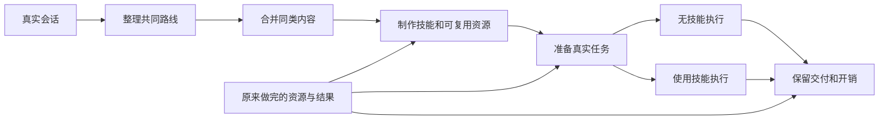

# 只用这一条管道

在 `D:\skillloop` 打开终端，只使用根目录的 `pipeline.py`。旧的二十多版目录留作历史，不用再逐个启动或恢复。

```powershell
python pipeline.py resume
```

这条命令会先拿回已经做好的技能、真实任务和完成结果，再继续没做完的部分。默认最多 8 路原生 OpenClaw 会话；同一通道不会同时挤进两个任务。

## 它具体做什么



整理路线时，只挑能替代重复规划、写代码、数据处理或多轮操作的内容。相同工作路线合成一个技能，业务内容变化当作输入变化；部分步骤相同的路线可以复用程序和模板，但每个技能最终有自己完整的一套资源。

制作技能时，模型用真实会话和附件，先复用已经写好的可靠资源。模型在制作会话里实际运行程序，写清命令、输入、参数、输出位置。首页只写短路线和入口，细节按阶段读取。制作记录放技能外。

业务执行时，原生 OpenClaw 按自己的方式读技能、用工具、完成交付。无技能和技能组的环境、模型、预算、任务和附件相同。技能指出路线并提供资源，交付质量由执行器负责。

不恢复额外的外部校验器、来源证明或注册链，但保留原方法中的价值筛选：先做能替代公共工作的可靠资源，再原生试用，交付达线且实际减负才保留。制作结果先是候选，不能有SKILL.md就当有效入库。当前50份包已更正为候选，完整价值取舍回路仍需补回，本轮没有启动新实验。

## 查看进度

```powershell
python pipeline.py status
```

打开 [进度和技能目录](D:/skillloop/output/workflow_library/progress.html)。这里能看到进程是否存活、正在处理哪条路线、还有多少会话没处理、技能放在哪里，以及两组的 Token、模型调用次数和交付结果。

生成的技能统一放在：

```text
D:/skillloop/output/workflow_library/skills/<路线名称>/
    SKILL.md
    程序、模板及按需读取的说明
```

已有17份资源已复用，本轮又继续制作，当前数量以页面为准。初筛覆盖1107条不等于所有技能和任务已经完成；旧导出漏接的候选会沿原判断归并接续，不重新筛全部会话。目录可用不等于已经证明性能提升。完整结果照用，负结果照列，用量不全写“未记全”，不按零计算。

## 暂停和继续

```powershell
python pipeline.py stop
```

这会停止新的任务派发。已经在跑的会话按原来的 1800 秒预算结束，结果和费用照常保留。

需要继续时仍运行同一条命令：

```powershell
python pipeline.py resume
```

不要删除 `output/workflow_library/state.db` 来“重置”。它记着哪些已经完成、哪些还没派发。外层中断后，管道先接回原生会话或现有结果，不盲目再发同一请求。旧状态不明的任务会明确列出，不假装没运行过。

## 配置和记录

只改根目录 `pipeline.json` 中的输入、输出位置和并发数，不需要找旧版协议或注册文件。默认并发数为 8。

新原生会话与产物在 `E:/skillloop_runs/workflow_library/`（D盘空间不足，仅更换宿主存储位置），制作和执行记录在 `output/workflow_library/records/`，旧费用在 `legacy_costs.json`。容器内输入、技能和输出路径不变。原来的失败、费用和数据都保留。制作费用与业务执行费用分开看。

环境保持原生 OpenClaw 2026.9.5、原固定镜像、`glm-5.3-flash`、原工具和依赖，1800 秒会话、32768 单回复上限。遇到 Docker 或目录访问受限时，页面会明确显示受阻；不能换一个自建执行器冒充恢复。

2026-10-23 02:00 起，权限已恢复并实际启动8路。Windows任务 `SkillLoop_SinglePipeline` 直接托管同一个 `pipeline.py resume`，不依赖聊天窗口，不增加独立守护或核验程序。日常查看和停止仍用上述同一入口。此前Docker权限拒绝的0模型启动失败保留；原8模型通道复用，没有重启或重复创建服务。
# 补齐遗漏，不打断现有任务

`python pipeline.py complete-coverage`：读取旧判断、恢复漏关联，并向同一队列追加补漏；不会启动第二个执行进程，也不会重复准备同一批。

`python pipeline.py coverage-status`：查看补漏903条中的已回答数量、百分比和各部分状态；不调用模型。204条已有明确无复用价值判断，本轮不重做。

原117条的主题提议已找回，不代表已通过路线判断。5条漏关联直接复用原决定恢复。现有50候选和原双臂结果保留；新小路线仍需制作可靠资源、真实试用并确实减负才保留。补漏先使用原任务没有待办的通道，总并发8，原生环境和预算不变。

