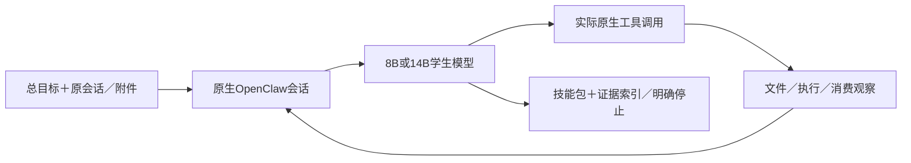

# 训练后模型的输入、动作与交付

这是期望部署接口说明，尚未训练或接通学生服务。完整能力还未由当前数据支撑。模型在原生OpenClaw中运行，真实文件与工具留在环境里；一个总目标可能需要多轮模型调用。

| 时点 | 模型实际收到 | 模型应产生 |
|---|---|---|
| 开始 | “从这些会话沉淀可复用skills”的总目标、原会话／附件入口、原生可发现技能与工具、预算／权限 | 阅读与检查动作、必要的决策说明，不先虚构素材和成功 |
| 探索与选择 | 原生read／搜索返回的实际内容、原用户纠正、当前已知资源 | 需求／失败机制归纳、复用／新建／合并／defer的选择及原生操作 |
| 制作 | 已确认路线、真实输入、可用依赖与当前文件版本 | SKILL.md、脚本／模板／资料的实际write／edit／exec；必要自测 |
| 消费与修订 | 同版本真实试做输出、具体错误、独立评审、已知用量 | 定位问题、局部修改、实际复测；无证据时继续检查或停止 |
| 收尾 | 当前版本的真实验证结果、资源目录、质量／成本证据 | 合格范围内的技能包与验证索引，或明确stop／defer／未满足项 |

每一轮可以有真实推理字段、可见说明、结构化tool_calls或终态文本；执行工具与返回观察由原生环境完成，不把伪造工具结果当模型输出。原生循环持续到真实交付／停止或预算结束。生成SKILL文本本身不等于沉淀完成。

SFT中，系统／用户／工具观察是输入，loss为0；只对独立获证的助手推理片段、判断与动作监督。未来trial可以用于审核早期动作，但不提前放进该动作输入。真实状态新标注可教阶段选择，必须声明新作者，不能冒称原Teacher本来就自发完成整链。

期望学到的因果关系是“当前证据支持什么→该读什么／制作什么→实际环境怎样反馈→为何修订或停止”。原R保留使可验证的推理过程可学，工具轨迹使推理落到资源，版本消费把修订与实际表现接起。缺B/C/D或没有学生自身历史上的闭环验证，就不能由这条设计推断模型已具完整自主能力。

当前检查点的输入输出主要是需求契约抽取和极少原R局部；437个目标不是437个完整自主沉淀任务。B及后续质量链仍在资源准入等待，不把本接口图或未来例子计作训练样本。
